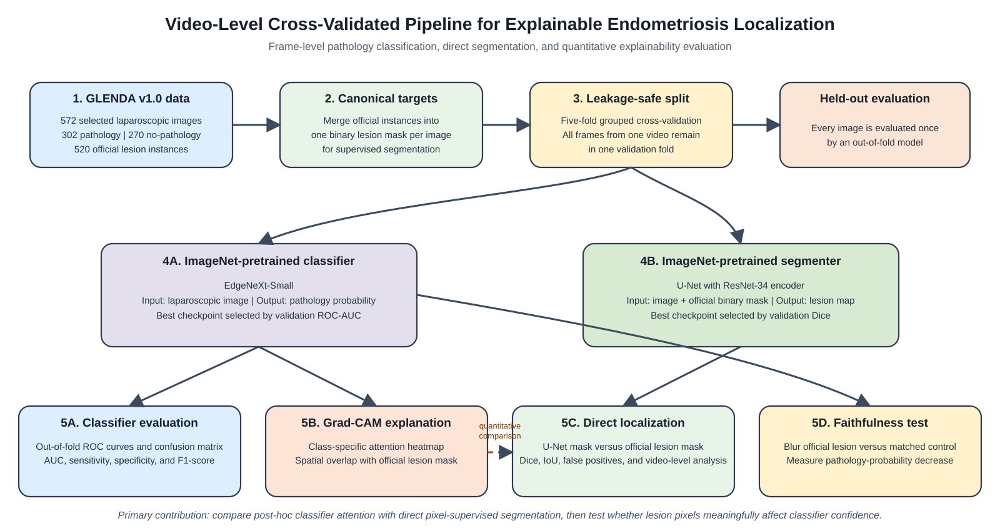

# GLENDA XAI Localization

> **Video-level cross-validated comparison of direct lesion segmentation and explainable classification for laparoscopic endometriosis localization.**

This repository provides the reproducible research workflow for evaluating two complementary approaches to localizing endometriosis lesions in laparoscopic images:

1. **Direct localization:** a U-Net with an ImageNet-pretrained ResNet-34 encoder, trained using official lesion masks.
2. **Explainable classification:** an ImageNet-pretrained EdgeNeXt-Small classifier interpreted with Grad-CAM.

The study uses the official GLENDA v1.0 dataset and a leakage-safe, video-level, five-fold cross-validation protocol. Every selected image receives one out-of-fold evaluation only.



## Repository layout

```text
glenda-xai-localization/
├── notebooks/
│   └── 01_glenda_xai_localization.ipynb   # End-to-end Colab workflow
├── configs/
│   └── experiment_config.yaml             # Central experiment settings
├── docs/
│   ├── data_access.md                     # Dataset access and handling
│   └── reproducibility.md                 # Reproduction protocol
├── figures/                               # Repository-level study-pipeline visual
├── paper/                                 # Manuscript PDF, LaTeX source, and paper figures
├── requirements.txt
└── .gitignore
```

## Study design

The analysis uses 572 selected GLENDA laparoscopic images: 302 pathology images and 270 no-pathology images. The official lesion-instance annotations are merged into one binary lesion mask per image for supervised segmentation. To avoid leakage between correlated video frames, all frames from a video remain in a single validation fold.

Two model families are evaluated within the same five-fold split:

| Task | Model | Selection criterion | Principal evaluation |
|---|---|---|---|
| Pathology classification | ImageNet-pretrained EdgeNeXt-Small | Validation ROC-AUC | Out-of-fold ROC-AUC, sensitivity, specificity, F1 |
| Lesion segmentation | U-Net with ImageNet-pretrained ResNet-34 encoder | Validation positive Dice | Dice, IoU, false-positive image rate |
| Explainability | Grad-CAM from the classifier | Fixed pilot-selected threshold | Overlap with official masks and faithfulness testing |

## Main results

Across the five held-out folds, the classifier obtained a mean ROC-AUC of **0.965 ± 0.011**. The direct segmentation model achieved a mean positive-image Dice score of **0.438 ± 0.049**. For held-out pathology videos, direct segmentation achieved mean localization Dice **0.459**, compared with **0.274** for classifier Grad-CAM.

The faithfulness analysis compared the classifier probability decrease after blurring an official lesion region with the decrease after blurring a matched non-lesion control region. The mean video-level decrease was 0.152 for lesion blur and 0.001 for matched control blur (difference 0.151; bootstrap 95% CI 0.113--0.193; one-sided Wilcoxon \(p=2.719\times10^{-23}\)).

These results support direct segmentation as the stronger spatial-localization method, while the counterfactual analysis provides evidence that classifier attention is clinically relevant rather than purely visual.

## Literature context and responsible comparison

The results are strong for this study's explicitly leakage-safe, video-grouped evaluation: the classifier achieved a mean five-fold ROC-AUC of 0.965, and direct segmentation improved held-out video-level localization relative to Grad-CAM (0.459 versus 0.274 mean Dice). They are consistent with the promising performance reported in the growing literature on AI-assisted endometriosis imaging.

They must **not** be interpreted as a claim of numerical superiority over other published systems. Direct cross-paper comparisons are not valid unless the dataset version, image-selection rules, lesion labels, prevalence, split unit, and evaluation metrics are matched. This repository therefore emphasizes transparent within-dataset comparison: both localization approaches use the same fixed, video-level folds, and the Grad-CAM analysis is complemented by a lesion-versus-matched-control faithfulness test. Recent reviews likewise identify rigorous validation and transparent reporting as necessary for clinical translation.

Useful context includes the [official GLENDA dataset release](https://ftp.itec.aau.at/datasets/GLENDA/), the earlier GLENDA-based study on [endometriosis detection and localization](https://doi.org/10.1007/s11042-021-11730-1), and a recent [systematic review of AI in endometriosis diagnosis](https://pmc.ncbi.nlm.nih.gov/articles/PMC13716802/). These sources provide context only; the numerical results reported here are derived from this repository's own out-of-fold evaluation.

## Quick start in Google Colab

1. Open `notebooks/01_glenda_xai_localization.ipynb` in Google Colab.
2. Select a CPU or GPU runtime. The notebook is checkpointed and can resume after an interruption; a GPU is recommended for training speed.
3. Mount Google Drive when prompted. The notebook creates a project directory in Drive, downloads the official archive, prepares the dataset, trains models, and saves checkpoints and outputs.
4. Run cells in order. Do not change the fixed fold metadata after model training begins.

The notebook includes guarded setup for the required packages. A Hugging Face token is optional for faster ImageNet-weight downloads but is not required.

## Data access and responsible use

The GLENDA dataset is not redistributed in this repository. Obtain it from the official source, review its license and access conditions, and cite the dataset publication in any derived work. Processed images, binary masks, model checkpoints, Drive caches, and any credentials must remain untracked.

See [docs/data_access.md](docs/data_access.md) for details.

## Reproducibility

The workflow saves fixed split manifests, training configurations, epoch-level histories, best and latest checkpoints, out-of-fold predictions, localization comparisons, and figure-ready outputs. The exact safeguards and expected outputs are listed in [docs/reproducibility.md](docs/reproducibility.md).

## Citation

If you use the GLENDA dataset, cite its official publication as required by its authors. A project-specific citation will be added here following manuscript acceptance or public preprint release.

## License

The software license will be selected before public release. Dataset materials are governed by the GLENDA dataset terms and are not included here.
