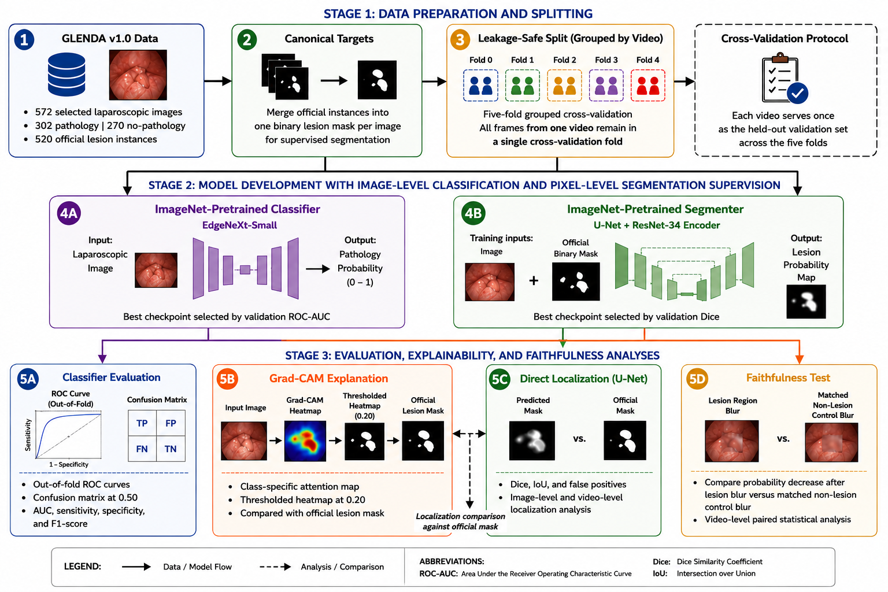

# GLENDA XAI Localization

> **Video-level cross-validated comparison of direct lesion segmentation and explainable classification for laparoscopic endometriosis localization.**

This repository provides the reproducible research workflow for evaluating two complementary approaches to localizing endometriosis lesions in laparoscopic images:

1. **Direct localization:** a U-Net with an ImageNet-pretrained ResNet-34 encoder, trained using official lesion masks.
2. **Explainable classification:** an ImageNet-pretrained EdgeNeXt-Small classifier interpreted with Grad-CAM.

The study uses the official GLENDA v1.0 dataset and a leakage-safe, video-level, five-fold cross-validation protocol. Every selected image receives one out-of-fold evaluation only.



## Repository layout

```text
glenda-xai-localization/
├── notebooks/
│   └── 01_glenda_xai_localization.ipynb   # End-to-end Colab workflow
├── configs/
│   └── experiment_config.yaml             # Central experiment settings
├── docs/
│   ├── data_access.md                     # Dataset access and handling
│   └── reproducibility.md                 # Reproduction protocol
├── figures/                               # Repository-level study-pipeline visual
├── paper/                                 # Manuscript PDF, LaTeX source, and paper figures
├── requirements.txt
└── .gitignore
```

## Study design

The analysis uses 572 selected GLENDA laparoscopic images: 302 pathology images and 270 no-pathology images. The official lesion-instance annotations are merged into one binary lesion mask per image for supervised segmentation. To avoid leakage between correlated video frames, all frames from a video remain in a single validation fold.

Two model families are evaluated within the same five-fold split:

| Task | Model | Selection criterion | Principal evaluation |
|---|---|---|---|
| Pathology classification | ImageNet-pretrained EdgeNeXt-Small | Validation ROC-AUC | Out-of-fold ROC-AUC, sensitivity, specificity, F1 |
| Lesion segmentation | U-Net with ImageNet-pretrained ResNet-34 encoder | Validation positive Dice | Dice, IoU, false-positive image rate |
| Explainability | Grad-CAM from the classifier | Fixed pilot-selected threshold | Overlap with official masks and faithfulness testing |

## Classifier evaluation and explainability

Across the five held-out folds, the ImageNet-pretrained EdgeNeXt-Small classifier obtained a mean ROC-AUC of **0.965 ± 0.011**. The repository also includes out-of-fold ROC curves, a threshold-0.50 confusion matrix, Grad-CAM visualizations, and the complete manuscript figure set.

## Quick start in Google Colab

1. Open `notebooks/01_glenda_xai_localization.ipynb` in Google Colab.
2. Select a CPU or GPU runtime. The notebook is checkpointed and can resume after an interruption; a GPU is recommended for training speed.
3. Mount Google Drive when prompted. The notebook creates a project directory in Drive, downloads the official archive, prepares the dataset, trains models, and saves checkpoints and outputs.
4. Run cells in order. Do not change the fixed fold metadata after model training begins.

The notebook includes guarded setup for the required packages. A Hugging Face token is optional for faster ImageNet-weight downloads but is not required.

## Data access and responsible use

The GLENDA dataset is not redistributed in this repository. Obtain it from the official source, review its license and access conditions, and cite the dataset publication in any derived work. Processed images, binary masks, model checkpoints, Drive caches, and any credentials must remain untracked.

See [docs/data_access.md](docs/data_access.md) for details.

## Reproducibility

The workflow saves fixed split manifests, training configurations, epoch-level histories, best and latest checkpoints, out-of-fold predictions, localization comparisons, and figure-ready outputs. The exact safeguards and expected outputs are listed in [docs/reproducibility.md](docs/reproducibility.md).

## Citation

If you use the GLENDA dataset, cite its official publication as required by its authors. A project-specific citation will be added here following manuscript acceptance or public preprint release.

## License

The software license will be selected before public release. Dataset materials are governed by the GLENDA dataset terms and are not included here.
